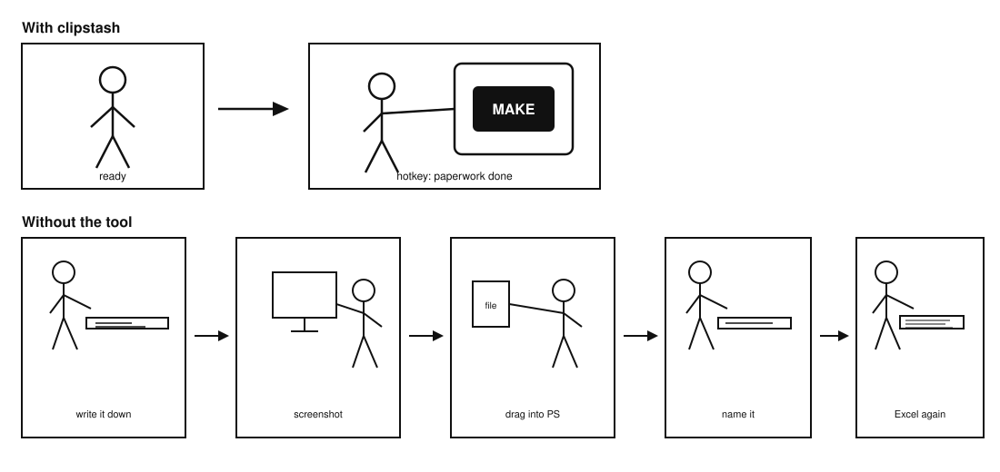

# Case study: clipstash for creator banner batches

**clipstash** is a Chrome-first tool that saves a **video still + title + source URL** as one reusable packet. This note is the product story: a real job (promotional banners for a creator across their social accounts), what hurts without a tool, and what the public extract keeps.

Public repo: [eriksjaastad/clipstash](https://github.com/eriksjaastad/clipstash).  
Known limits and deferred ideas: [ISSUES.md](./ISSUES.md).



*Top: push MAKE (the hotkey). Bottom: write it down, again and again. Create banner (−) is the same later either way.*

---

## The job

You are tasked with making a bunch of promotional banners for a creator. You need to go through their videos (often across **YouTube, TikTok, Instagram, and Twitter/X**), pick usable frames, drop them into a Photoshop template (layer masks, layout), export finished banners, and keep a reliable log of what you used and where it came from.

That is not a one-off screenshot. It is a **batch** job. The more you have to make, the more the friction matters. Making five is mildly annoying. Making a hundred per category is where a purpose-built loop pays for itself.

---

## Without the tool

1. Find the video
2. Take a screenshot
3. Screenshot lands wherever the OS put it
4. Drag the file into Photoshop
5. Create banner (−)
6. Export
7. Type the name when you save (into the folder you already set up)
8. Paste the image name into Excel
9. Copy the video page URL and paste that into Excel too

Repeat across YouTube, TikTok, Instagram, and Twitter/X, and across dozens or hundreds of videos. The slow part is not the creative work. It is everything around it.

---

## With clipstash

The hotkey does the **paperwork**: saves the still with a usable name, writes the YAML (title, URL, and the rest), and keeps a log you can walk later. With Photoshop place on, the still also lands in your open Photoshop file as a layer with that name. You can also batch a pile of captures first and do the Photoshop work in a separate pass.

**Capture pass** (good when you can pause on the frame you want):

1. Open the video URL
2. Hotkey → still saved, named/organized, recorded in YAML
3. With Photoshop place on, the still arrives in your open Photoshop file as a layer with the right name. No dragging, no renaming.

**Then** the image work:

4. Create banner (−)
5. Export

Create banner is the same either way (−). What the tool removes is screenshot filing, naming, dragging into Photoshop, and the Excel name/URL bookkeeping. In the workflow we used, capturing the clip was the whole step: the layer showed up in the open file already named. Fast, and self-documenting.

**Optional extras** (not required for the happy path):

- Burst / bracket frames around the pause when the moment is hard (blink, mid-motion). Short clips often pause cleanly, so the case study default is the single hotkey.
- Photoshop place is off by default and macOS only (popup checkbox, or `clipstashd serve --photoshop`). Turn it on for the one-step flow above; leave it off if you are batching stills first. On current Photoshop releases the helper copies the still's layer into the frontmost document, and if that script cannot run it opens the still as a new document instead.
- Popup **Still name** type-in when the video title is a bad filename; otherwise the default is a slug of the title.

Clipboard history in the extension is a convenience. The **packet** is the source of truth:

```text
~/Clipstash/packets/<site>/<id>/
  <slug>.png    # slugified video title (or popup type-in override)
  record.yaml   # title, URLs, site, image/name, capture_method, timestamp, …
```

`<site>` is one of `youtube`, `tiktok`, `instagram`, `x`, or `generic`. Site adapters own title and URL for each site. Capture code owns the still.

On **YouTube, TikTok, and Instagram** creator grids, thumbs you have already captured get a **green check** (matched by canonical URL against the packet log). X/Twitter uses a different layout; green-check does not apply there.

---

## Why volume is the point

At five banners, the tool saves some time. At a hundred per category, the filing and spreadsheet steps are what would have burned the day, and those are exactly what the hotkey removes.

Tools like this were used on large creator assignments. The point is not a prettier screenshot. It is still + title + URL written down for you, every time, so remakes and exports are not a scavenger hunt.

---

## Architecture that survived the extract

```text
Chrome extension (MV3)
  adapters → capture / burst → clipboard history → green-check overlay
        │
        ▼  localhost HTTP
Local helper (clipstashd)
  write packets · burst picker · CSV · optional Photoshop
```

Why a helper? Browser canvas capture is fast when it works, but cross-origin `<video>` (common on YouTube) taints the canvas. Prefer media-native frames (download/decode + ffmpeg) when you can; keep a visible-tab + crop fallback when you cannot. Disk write and a multi-frame picker are cleaner outside the extension process.

v1 capture ladder:

| Path | When |
|------|------|
| In-page canvas | Untainted `<video>` draw |
| Helper ffmpeg burst | Tainted burst: fetch media → ±7 × 0.15s PNGs → picker |
| Visible-tab + crop | Fallback: full-tab shot cropped to the video’s on-screen rect |

Install aims at “boring for strangers”: Homebrew formula and/or a local PyInstaller binary plus LaunchAgent. We are **not** joining the Apple Developer Program or notarizing downloadables; brew/source (and local unsigned builds) are the supported paths.

---

## What we deliberately left behind

| Left in private / deferred | Why |
|----------------------------|-----|
| Style / face scoring gates | Tuned to one corpus; not the packet product |
| Catalogue numbering / finish export directories | Client ops; public v1 stops at packet + optional place |
| Review dashboard / timed links | Client delivery surface |
| Real captures, sheets, worklists | Never publish |
| Windows/Linux helper parity | macOS first |
| Chrome Web Store polish | Sideload docs first |
| Apple notarization / Developer Program | Not needed for brew/source |

The extract rule that kept us honest: **rewrite for the packet model; do not scrub-and-push the private tree.** Then grow the public tool toward the batch workflow this case study describes.

---

## What’s next

Richer CSV/spreadsheet export. Everything else is in [ISSUES.md](./ISSUES.md).

Naming, site folders, and the green-check grid are **shipped**. They are part of the product story above, not future ideas.

---

## How it was built (short)

- Plan and Kanban board first, then a public empty repo and synthetic demo packets only.
- Slices shipped as small PRs: schema → extension + history → adapters → burst picker → Photoshop → install → naming/site folders → green-check.
- Behaviour docs live next to code with drift-guard tests; markdown keeps the why/how story (README, `ISSUES.md`, this file).

The product lesson: **end a client job by naming the transferable object** (here, the packet), rewrite around it, leave engagement-specific machinery in the archive, and let volume, not novelty, justify the next features.

---

## What “done” looks like for v1

- Packets on disk under `packets/<site>/…` with slugified still names and stable YAML records
- CSV export from the helper
- Four site adapters + generic fallback
- Clipboard history in the extension
- Burst + picker, including ffmpeg path for cross-origin video
- Optional macOS Photoshop place with clear automation errors
- Green-check on already-captured YT / TikTok / IG grid thumbs
- Homebrew / single-binary install story
- MIT license, public GitHub, no client data in tree

v1 is the capture + packet core for the banner-factory loop. Remaining polish (richer export) can grow without changing the packet model.

---

## If you are extracting your own tool

1. Write the one-line **job** before you copy files (ours: batch creator banners across social video).
2. Name the source-of-truth artifact (ours is the packet folder + record).
3. Draw a hard “never publish” list on day one.
4. Prefer adapters and capture modes you can explain in a table over a monolith grab script.
5. Ship a stranger install path before you polish platform edge cases (TCC, Store). Skip paid Apple notarization unless you need downloaded prebuilts.
6. Optimize for the **hundredth** capture, not the demo of five.

clipstash exists because the client work ended, and because the still + title + URL habit did not.
